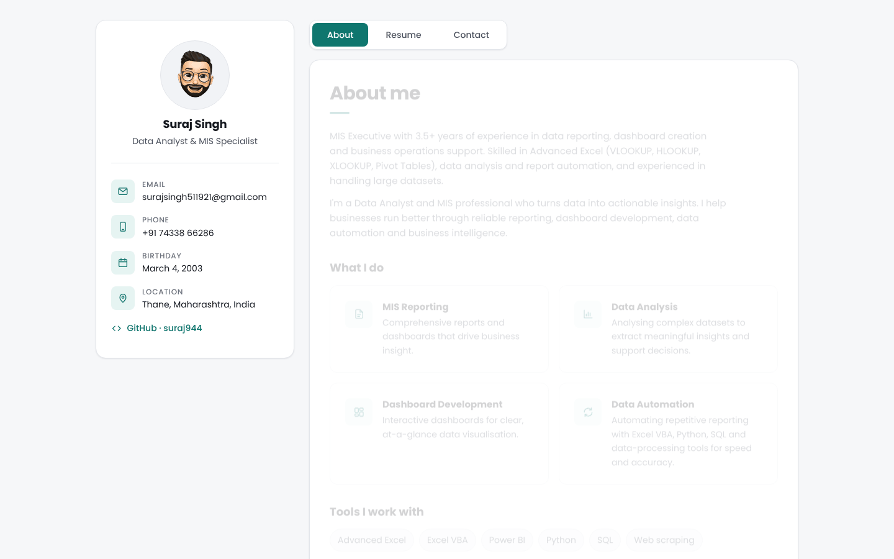

# Suraj Singh – Portfolio

Personal portfolio for Suraj Singh, Data Analyst & MIS Specialist based in Thane, India.



## What's here

- **About** – summary, services and the tools I use
- **Resume** – experience, education and skills
- **Projects** – my public GitHub repositories, loaded live from the GitHub API (forks hidden, filter by language)
- **Contact** – a contact form (sent by email through [FormSubmit](https://formsubmit.co)) and a map

Each section has its own link: `/#about`, `/#resume`, `/#projects`, `/#contact`.

To make a project look good on the Projects tab, give its GitHub repository a short description, and put
the live URL in the repository's **Website** field so a "Live site" button appears.

## Tech

Plain HTML, CSS and JavaScript with no build step and no frameworks. Icons are inline SVG, so the
only outside requests are the Poppins font (Google Fonts), the Google Maps embed, the form endpoint and the GitHub API.
The site follows the visitor's light or dark system setting.

```
index.html            page markup
assets/css/style.css  design tokens, layout and components
assets/js/script.js   section tabs, contact-details toggle, contact form
assets/images/        avatar and favicon
```

## Run locally

```bash
python3 -m http.server 8000
# open http://localhost:8000
```

## Deploy

Every push to `main` deploys to GitHub Pages through `.github/workflows/static.yml`.

## Contact form setup

FormSubmit asks the receiving address to confirm itself the first time the form is used. Send one test
message from the live site, then click the activation link FormSubmit emails to
surajsingh511921@gmail.com. Until then the form shows an error that explains this.


## Updating CSS or JavaScript

`index.html` loads `style.css?v=2` and `script.js?v=2`. When you change either file, raise the number
(`?v=3`, …) so returning visitors' browsers fetch the new file instead of a cached copy.
